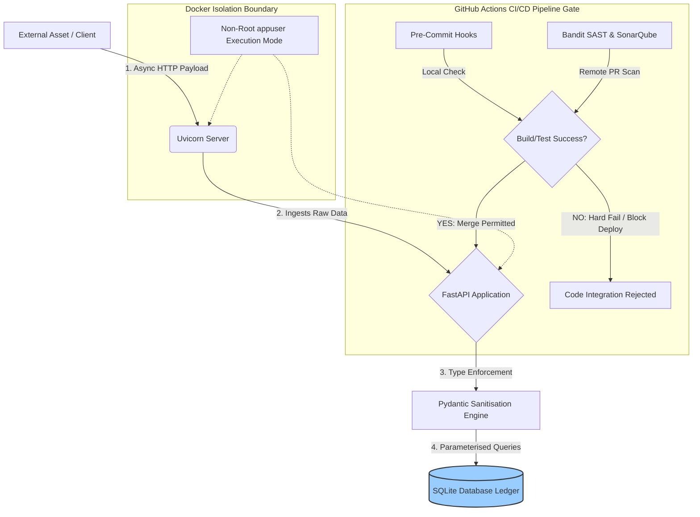

# Dual-Perspective Asset Management & Telemetry System
### Asynchronous Data Ingestion Engine & DevSecOps AppSec Perimeter

[](#-cicd-pipeline--quality-control)
[](SECURITY.md)
[](#-sast--security-hardening)
[](#-testing-suite--resilience)

An asynchronous, containerised, near-production-grade telemetry engine built using a modern Python stack (**FastAPI, SQLAlchemy, Pydantic**). This system handles high-concurrency real-time asset data streams, enforces strict data contracts, maps relational persistence layers, and implements a hard-gated GitHub Actions CI/CD and SAST security pipeline.

---

## IMPORTANT
**Note for Reviewers:** Active development is focused on expanding micro-service testing matrices and horizontal database migration benchmarks. For a comprehensive breakdown of known operational constraints and resolved technical debt, please see our active backlog via our repository's **issues and pull requests.**

## System Architecture Blueprint

This diagram illustrates how code changes are statically validated via GitHub Actions before deployment, while showing the runtime path of real-time client telemetry payloads streaming through our application layers.



---

## TRACK A: Software Engineering Focus (SWE)
*Targeting Core Architecture, Scalability, and Clean Code Standards*

### Asynchronous Ingestion Loop & Concurrency
*   **The Framework:** Built natively on **FastAPI** and **Uvicorn** to leverage asynchronous Python paradigms (`async/await`).
*   **Engineering Impact:** Telemetry ingestion endpoints handle high-volume, concurrent asset status alerts efficiently without blocking server I/O execution threads. This ensures minimal system processing latency.

### Relational Abstraction Layer
*   **The Component:** Relational entity data-mapping is driven by **SQLAlchemy ORM**.
*   **Engineering Impact:** Decouples core business logic from raw transactional code. The relational table configurations map directly to Python classes, allowing the transactional ledger (**SQLite**) to remain fully modular and ready for drop-in scale upgrades to PostgreSQL.

### Simulated Enterprise Team Workflows
*   **Architectural Accountability (ADR):** Architectural evolution is tracked using formal **Architecture Decision Records (ADR 001)** to document and justify the selection of the core asynchronous stack.
*   **Git Governance Framework:** Incorporates custom Issue templates, Referrer PR templates (`Feature`, `Chore`, `Fix`), automated reviewer assigners, and strict label pipelines to mirror real-world peer code review and repository release cycles.
* **Architectural Guardrails**: Leveraged Large Language Models (LLMs) as technical sounding boards to validate asynchronous async/await loop topologies and audit structural STRIDE threat matrices.
* **Verification & Synthesis**: Rather than executing blind code generation, AI was utilized to rapidly synthesize boilerplate test structures (Pytest configurations) and document system layouts, which were then manually refactored, type-checked via Pydantic, and verified through our automated local pre-commit gates.

---

## TRACK B: Cybersecurity Focus (AppSec)
*Layer Security, Targeting Threat Modeling, Vulnerability Mitigation, and Isolation*

### TCP/IP Layered Security

* **Application Layer Security (HTTP/TLS):** Enforces data transit safety by configuring the FastAPI application to operate strictly over HTTPS (TLS), mitigating the risk of packet-sniffing or Man-in-the-Middle (MitM) interceptions at the Application layer.
* **Transport Layer Boundary (TCP/Uvicorn):** Utilizes Uvicorn to handle low-level TCP socket connections asynchronously. The containerized ports are explicitly isolated so that external TCP traffic can only interface with the exposed application gateway, blocking unauthorized network scanning vectors.


### Component-Based STRIDE Threat Model
Rather than analyzing individual features, this repository isolates systems vulnerabilities using a **Component-Based STRIDE Mitigation strategy**:

*   **Spoofing (S) & Tampering (T):** Countered at the **Ingestion Boundary**. All network payloads pass through **Pydantic Validation Schemas** and `pydantic[email]` filters. Inputs that violate the exact schemas are dropped with a `422 Unprocessable Entity` block before they can execute logic or access the database.
*   **Information Disclosure (I) & Repudiation (R):** Handled at the **Persistence Boundary**. Database transactions are programmatically parameterized via SQLAlchemy to completely wipe out SQL Injection (SQLi) threat surfaces. Core system logs are parsed via Uvicorn pipelines into an append-only transaction history table to protect log auditability.
*   **Denial Of Service (D)**: Handled at the **Ingestion Boundary**, all network payloads are attached to the user's IP address, which is logged through **SlowAPI's** IP-based rate-tracking system, if a client requests a server resource or attempts to execute certain logic (registration and login systems) exceeding the configured rate (e.g. 7 requests per minute), they are dropped with a `429 Too Many Requests` block, preventing them from overwhelming the server with excessive requests.
*   **Elevation of Privilege (E):** Implemented at the **Infrastructure Boundary**. The application environment is containerised via **Docker**. The Dockerfile explicitly pins a low-privileged system user account (`USER appuser`), stripping the active runtime container of host root permissions to stop escape attacks.

*Currently, we are pitching a STRIDE analysis, assuming that the attacker has a low competency. For STRIDE models considering attackers with higher competency, please click [here](docs/security/threat_model.md).*

### Automated DevSecOps Governance
*   **Pre-Commit Defensive Gating:** Local pre-commit hooks intercept local developer workflows, recursively checking files for credentials leaks or security regressions before staging code to Git history.
*   **SAST Hard-Fail Binary Gate:** The **GitHub Actions CI/CD Pipeline** executes continuous **Bandit SAST** AST-parsing scans and **SonarQube Cloud** assessments on every Pull Request. The pipeline enforces a binary hard-fail rule: any identified vulnerability or test failure returns a non-zero code and **blocks branch compilation**.

---

## Testing Suite & Assurance Logs

The repository maintains an automated, metric-driven validation suite using **Pytest**:
*   **Quality Coverage Metrics:** Powered by `pytest-cov` to track statement coverage rules across all application and storage components.
*   **Report Compilers:** Uses `pytest-json` and `pytest-md` to format raw test outputs into human-readable Markdown telemetry summaries, automatically posted back onto GitHub pull requests.
*   **Automated Ledger Logging:** Every automated test execution logs execution metrics to a local database ledger table to verify and trace pipeline history over time.

```bash
# Execute local unit, functional, and reporting testing metrics
pytest --cov=app --cov-report=term-missing --md=report.md --json=report.json
```

---

## Environment Initialization

### Prerequisites
*   Docker & Docker Compose installed.

### Containerized Orchestration (Non-Root Deployment)
To spin up the isolated, containerized environment in daemon mode, run:
```bash
docker-compose up --build -d
```
🔗 **Swagger UI Interactive API Panel:** Access the auto-generated documentation panel via Uvicorn at `http://localhost:8000/docs`

---

## Engineering Roadmap & Backlog (Current & Future changes)
*   [x] Complete full architectural baseline documentation and STRIDE threat modeling.
*   [x] Establish SonarQube Cloud SAST hooks within the active CI/CD cycle.
*   [ ] Implement an asynchronous event-streaming broker layer (Redis/RabbitMQ) to manage distributed message queues under heavy network load.

For more proposed/ongoing changes, please see our project's **issues and pull requests.**
