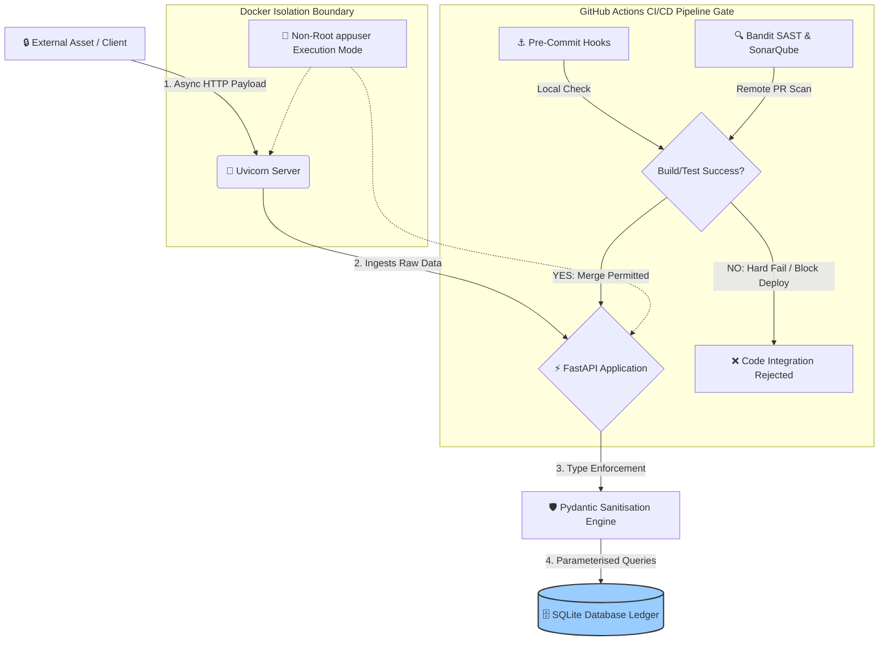

# 🛰️ Dual-Perspective Asset Management & Telemetry System
### Asynchronous Data Ingestion Engine & DevSecOps AppSec Perimeter

An asynchronous, containerised, near-production-grade telemetry engine built using a modern Python stack (**FastAPI, SQLAlchemy, Pydantic**). This system handles high-concurrency real-time asset data streams, enforces strict data contracts, maps relational persistence layers, and implements a hard-gated GitHub Actions CI/CD and SAST security pipeline.

---

## 🗺️ System Architecture Blueprint

This diagram illustrates how code changes are statically validated via GitHub Actions before deployment, while showing the runtime path of real-time client telemetry payloads streaming through our application layers.

---

## TRACK A: Software Engineering Focus (SWE)
*Targeting Core Architecture, Scalability, and Clean Code Standards (Amazon & PwC)*

### Asynchronous Ingestion Loop & Concurrency
*   **The Framework:** Built natively on **FastAPI** and **Uvicorn** to leverage asynchronous Python paradigms (`async/await`).
*   **Engineering Impact:** Telemetry ingestion endpoints handle high-volume, concurrent asset status alerts efficiently without blocking server I/O execution threads. This ensures minimal system processing latency.

### Relational Abstraction Layer
*   **The Component:** Relational entity data-mapping is driven by **SQLAlchemy ORM**.
*   **Engineering Impact:** Decouples core business logic from raw transactional code. The relational table configurations map directly to Python classes, allowing the transactional ledger (**SQLite**) to remain fully modular and ready for drop-in scale upgrades to PostgreSQL.

### Simulated Enterprise Team Workflows
*   **Architectural Accountability (ADR):** Architectural evolution is tracked using formal **Architecture Decision Records (ADR 001)** to document and justify the selection of the core asynchronous stack.
*   **Git Governance Framework:** Incorporates custom Issue templates, Referrer PR templates (`Feature`, `Chore`, `Fix`), automated reviewer assigners, and strict label pipelines to mirror real-world peer code review and repository release cycles.

